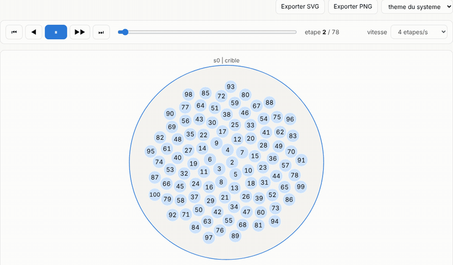
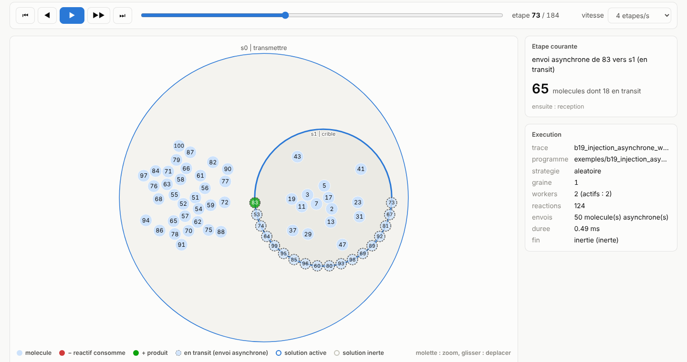
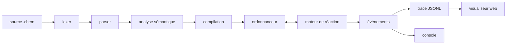

<div align="center">

# ⚗️ Chem Interpreter

### Programmez comme une réaction chimique.

Un langage où **les données sont des molécules** qui flottent dans une solution, et où **le programme est un ensemble de réactions**.
Pas de boucle, pas d'ordre d'exécution, pas d'état partagé : les molécules réagissent jusqu'à ce que plus rien ne bouge.

[](https://github.com/senechalmatisse/chemical-interpreter/actions/workflows/ci.yml)
[](engine/)
[](engine/Cargo.toml)
[](engine/tests/)
[](visualizer/)
[](visualizer/)
[](visualizer/)



*Le crible d'Ératosthène en une seule règle : chaque multiple réagit avec un de ses diviseurs et disparaît.*

[Essayer en 30 secondes](#-essayer-en-30-secondes) · [Visualiseur en ligne](https://senechalmatisse.github.io/chemical-interpreter/) · [Le langage](#-le-langage-en-une-minute) · [Le visualiseur](#-voir-les-réactions) · [Sous le capot](#-sous-le-capot) · [Documentation](#-documentation)

</div>

---

## 🧪 Le crible d'Ératosthène en deux lignes

```
let crible = replace x, y by x if y mod x == 0 ;
{ 2..100 | crible }
```

```console
$ chem run exemples/b09_crible_100.chem
{ 2, 3, 5, 7, 11, 13, 17, 19, 23, 29, 31, 37, 41, 43, 47, 53, 59, 61, 67, 71, 73, 79, 83, 89, 97 | crible }
```

Aucune boucle, aucun indice, aucun tableau de booléens. On décrit **ce qui doit se passer** (« un multiple disparaît face à son diviseur »), jamais **dans quel ordre**. C'est la programmation chimique, issue du formalisme **Gamma** (Banâtre et Le Métayer) : un modèle naturellement parallèle, puisque des réactions sur des molécules différentes peuvent avoir lieu en même temps.

## ✨ Ce que fait ce projet

<table>
<tr>
<td width="50%" valign="top">

**Un vrai langage**
Entiers, booléens, chaînes, n-uplets, intervalles, règles de toute arité. Une grammaire EBNF, un analyseur écrit à la main et des messages d'erreur qui montrent l'endroit exact du problème.

</td>
<td width="50%" valign="top">

**Parallèle, vraiment**
`--workers 4` et les réactions indépendantes s'exécutent en même temps. Aucune molécule consommée deux fois, aucun interblocage, garanti par construction et vérifié par 100 exécutions répétées.

</td>
</tr>
<tr>
<td valign="top">

**Des solutions dans les solutions**
Des sous-programmes calculent chacun de leur côté, puis se **dissolvent** dans leur parent ou reçoivent de nouvelles données par **injection**.

</td>
<td valign="top">

**Tout est observable**
Chaque réaction est tracée. On la rejoue, on la vérifie, on la regarde dans la console pas à pas ou dans un visualiseur web animé.

</td>
</tr>
<tr>
<td valign="top">

**Envoyer des données à un calcul en cours**
Une règle peut **injecter** des molécules dans un sous-programme **pendant qu'il tourne**, sans attendre qu'il ait fini : les molécules voyagent par une boîte aux lettres et rejoignent le calcul au fil de l'eau.

</td>
<td valign="top">

**Une fois, et pas plus**
Les règles `replace-one` ne s'appliquent qu'une seule fois, puis disparaissent. Avec les règles sans réactif, elles amorcent un calcul ou bornent un flux d'injections.

</td>
</tr>
</table>

## 🚀 Essayer en 30 secondes

```sh
git clone <ce-depot> && cd chemical-interpreter/engine
cargo build --release                                                           # aucune dépendance externe : compile hors ligne

./target/release/chem run ../exemples/b01_maximum.chem
./target/release/chem run ../exemples/b06_dissolution.chem --workers 4 --stats
./target/release/chem run ../exemples/b01_maximum.chem --pas-a-pas              # Entrée, Entrée, Entrée...

cargo build --release --manifest-path ../integrations/Cargo.toml                # la même commande avec Rayon, Clap, Serde et Miette
```

Seul prérequis : Rust (la version 1.99.1 est installée automatiquement par `rust-toolchain.toml`).

## 📖 Le langage en une minute

Une **règle** remplace des molécules par d'autres, à une condition :

```
let max = replace x, y by x if x >= y ;    # deux nombres -> le plus grand
{ 4, 17, 9, 17, 2 | max }                  # une solution et ses règles actives
```

Résultat : `{ 17 | max }`. Peu importe l'ordre des réactions, il ne reste que le maximum.

Les solutions s'emboîtent, et c'est là que ça devient intéressant :

```
let max   = replace x, y by x if x >= y ;
let vider = replace s:sol by dissolve(s) ;

# trois sous-programmes calculent leur maximum en parallèle,
# puis chacun se dissout dans la solution principale
{ { 4, 17, 9 | max }, { 21, 3 | max }, { 8, 8, 2 | max } | vider, max }
```

```console
$ chem run exemples/b06_dissolution.chem --workers 4
{ 21 | vider, max }
```

Un sous-programme peut même recevoir des données **pendant qu'il calcule**. `s:ref` désigne une sous-solution sans l'arrêter ni attendre la fin de son calcul, et `inject` lui envoie des molécules :

```
let crible      = replace x, y by x if y mod x == 0 ;
let transmettre = replace x:int, s:ref by inject(x, s) ;

# la sous-solution crible 2..50 pendant qu'on lui envoie 51..100
{ 51..100, { 2..50 | crible } | transmettre }
```

Et une règle `replace-one` ne s'applique qu'une fois, même si elle reste applicable :

```
let amorcer = replace-one by 10, 20, 12 ;   # aucun réactif : applicable même dans une solution vide
let somme   = replace x, y by x + y ;
{ | amorcer, somme }                        # résultat : { 42 | somme }
```

Et quand on se trompe, l'interpréteur le dit clairement :

```
erreur[E0304]: variable 'z' non liee
 --> max.chem:2:37
  |
2 | let max = replace x, y by x if x >= z ;
  |                                     ^ absente des reactifs
  |
  = aide : vouliez-vous dire 'x' ?
```

<details>
<summary><b>20 programmes d'exemple</b> : maximum, somme, PGCD, tri, factorielle, chaînes, injection asynchrone…</summary>

| Programme | Ce qu'il montre | Résultat (règles omises) |
|---|---|---|
| `b01_maximum` | la réaction la plus simple | `{ 17 }` |
| `b02_somme` | intervalle `1..100` | `{ 5050 }` |
| `b03_crible` | crible d'Ératosthène | les 15 premiers ≤ 50 |
| `b04_pgcd` | deux règles qui coopèrent | `{ 6 }` |
| `b05_tri` | tri par échanges sur des n-uplets | `{ (0, 1), (1, 3), (2, 5), (3, 8) }` |
| `b06_dissolution` | sous-programmes parallèles puis dissolution | `{ 21 }` |
| `b07_injection` | injection et réactivation d'une sous-solution | `{ { 25 } }` |
| `b08_max_min` | deux calculs indépendants en parallèle | `{ { 17 }, { 2 } }` |
| `b10_max_doublons` | `x > y` : les doublons du maximum survivent | `{ 17, 17 }` |
| `b11_factorielle` | produit de 1 à 10 | `{ 3628800 }` |
| `b13_difference` | programme **non confluent** : le résultat dépend de l'ordre | une valeur impaire |
| `b14_arite3` | règle à trois réactifs | `{ 45 }` |
| `b15_imbrication` | trois niveaux de dissolutions en cascade | `{ 10 }` |
| `b16_chaines` | chaînes et booléens | `{ false, "rouge" }` |
| `b17_usage_unique` | règles `replace-one`, activées une ou deux fois | `{ 15 }` |
| `b18_sans_reactif` | règle sans réactif dans une solution vide | `{ 42 }` |
| `b19_injection_asynchrone` | crible alimenté **pendant** son exécution | `{ { 2, 3, …, 97 } }` |
| `b20_injection_bornee` | injections bornées : `replace-one` et `s:ref` | `{ { 50 } }` |

Tous dans [`exemples/`](exemples/), avec leur résultat attendu vérifié automatiquement.

</details>

## 👀 Voir les réactions

```sh
chem run exemples/b06_dissolution.chem --workers 4 --trace-jsonl b06.jsonl
cd visualizer && npm install && npm run build && cd ..
chem viz b06.jsonl                                                              # ouvre le navigateur sur la trace
```


- **Les réactions sont animées** : les réactifs passent au rouge et disparaissent, les produits apparaissent en vert à leur place.
- **On peut remonter le temps** : pas à pas en avant, en arrière, ou saut direct à n'importe quelle étape.
- **On voit le parallélisme** : la frise montre ce que chaque worker faisait, et à quel moment.
- **On voit le courrier** : les molécules injectées de façon asynchrone attendent, en pointillé, au bord du sous-programme qui tourne, puis le rejoignent à leur réception.
- **On garde une trace** : export SVG ou PNG, thème clair ou sombre, raccourcis clavier.

Onze démonstrations sont incluses, dont le crible jusqu'à 1 000 exécuté sur 4 workers et un crible alimenté par injection asynchrone :



## Workflow



**Le parallélisme sans verrou.** Une solution est découpée en lots ; chaque worker **possède** son lot, au sens du système de types de Rust. Deux workers ne peuvent donc pas consommer la même molécule, et c'est le compilateur qui le garantit. Quand les lots sont stables, ils fusionnent deux à deux, jusqu'à une dernière passe qui prouve que plus aucune réaction n'est possible.

**Des résultats reproductibles, même en parallèle.** À graine fixée, le découpage ne dépend que de la structure du programme, jamais du hasard de l'ordonnancement des threads.

**Des messages sans attente.** L'injection asynchrone passe par une boîte aux lettres : l'expéditeur réserve, puis dépose ; une règle qui veut lier la sous-solution la ferme d'abord, ce qui échoue si du courrier attend. Aucune molécule n'est perdue, aucun thread n'attend l'autre, et l'inertie reste exacte : une solution n'est inerte qu'une fois tout son courrier traité.

**Une trace qui se vérifie elle-même.** `chem replay trace.jsonl --programme prog.chem` ré-exécute chaque réaction enregistrée et vérifie la condition, les produits, l'absence de double consommation, le courrier envoyé et reçu, et qu'une règle `replace-one` ne sert qu'une fois. Une exécution parallèle devient ainsi une exécution séquentielle valide.

**Des jointures en temps linéaire.** Une condition d'égalité entre deux réactifs (`replace (a, b), (c, d) by (a, d) if b == c`) n'essaie plus tous les couples : les molécules sont rangées par valeur, et chaque recherche ne regarde que les partenaires qui ont la bonne clé. Une analyse à la compilation garantit que l'index ne change ni les réactions possibles ni les erreurs signalées. Pour les jointures symétriques (`x == y`, `k == l`), les lots parallèles sont en plus répartis par clé : chaque groupe de même clé réagit en entier dans un seul lot, et la phase se passe même des fusions quand la règle garde ses clés. Les chaînes (`b == c`) sont coupées en segments que les lots contractent en parallèle, et pour les longues chaînes le découpage lui-même est réparti entre les workers.

**Zéro dépendance, quatre bibliothèques branchées.** Le moteur n'utilise que la bibliothèque standard. Rayon (pool à vol de tâches), Clap (arguments), Serde (trace) et Miette (rendu des erreurs) se branchent chacun sur une interface du moteur, dans le paquet [`integrations/`](integrations/), derrière sa propre fonctionnalité Cargo : même commande, mêmes résultats, et des tests d'équivalence le vérifient.

**Vérifié à chaque commit.** L'intégration continue teste le moteur sous Linux, macOS et Windows, chaque intégration seule, rejoue les tests de concurrence avec les deux exécutables, audite les dépendances, mesure la couverture et la performance, et publie le visualiseur en ligne ([`docs/integration-continue.md`](docs/integration-continue.md)).

**Une architecture lisible.** Chacun des choix est justifié dans [`docs/architecture.md`](docs/architecture.md).

### Quelques chiffres

| | |
|---|---|
| Maximum de 10 000 entiers | **1,3 ms** |
| Crible jusqu'à 1 000 | **23 ms** |
| Accélération avec 4 workers (réactions indépendantes) | **×2,05**, sur une machine de 2 cœurs |
| Jointure d'une chaîne de 3 000 maillons (`if b == c`) | **1,6 ms** au lieu de 165 ms, grâce à l'index par valeur |
| Doublons de 40 000 valeurs, 4 workers | **×2,2** face à la distribution circulaire, grâce à la répartition des lots par clé |
| Chaîne de 30 000 maillons, 2 cœurs | **×1,4** face à un seul worker, grâce à la contraction par segments |
| Découpage d'une chaîne de 300 000 maillons | **15 ms** au lieu de 31 ms sur un cœur, **12 ms** sur deux |
| Tests | **159** pour le moteur, **18** pour les intégrations, **22** côté visualiseur |
| Dépendances externes du moteur | **0** |

Méthode et analyse complètes : [`docs/performance.md`](docs/performance.md).

## 📚 Documentation

| | |
|---|---|
| [Manuel du langage](docs/langage.md) | grammaire, sémantique, priorités, tous les codes d'erreur |
| [Manuel utilisateur](docs/utilisateur.md) | commandes, options, codes de retour, visualiseur, scripts |
| [Format de trace](docs/format-trace.md) | le format JSON Lines et son rejeu |
| [Architecture](docs/architecture.md) | modules, algorithme parallèle et preuves de correction |
| [Performances](docs/performance.md) | mesures séquentiel contre parallèle, index par valeur, analyse |
| [Intégration continue](docs/integration-continue.md) | workflows GitHub Actions, équivalents locaux, règles de la branche principale, publication |

## 🗂️ Organisation du dépôt

```
chemical-interpreter/
├── engine/        moteur Rust : lexer, parser, sémantique, moteur, ordonnanceur, trace, CLI
├── integrations/  Rayon, Clap, Serde et Miette branchés sur les interfaces du moteur
├── visualizer/    application React + TypeScript + D3
├── exemples/      20 programmes avec résultat attendu, et des scénarios de performance
├── docs/          manuels, architecture, performances
└── scripts/       qualité, tests de concurrence, mesures, démonstrations
```

## 📜 Références

- J.-P. Banâtre, D. Le Métayer, *Programming by multiset transformation*, Communications of the ACM, 36(1), 1993
- [Le formalisme Gamma](https://hal.inria.fr/inria-00000949/document)
- HOCL, le langage chimique d'ordre supérieur, pour les solutions imbriquées et la dissolution
